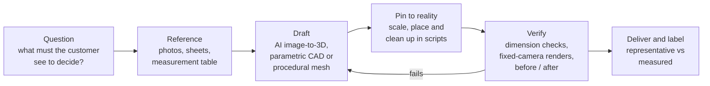
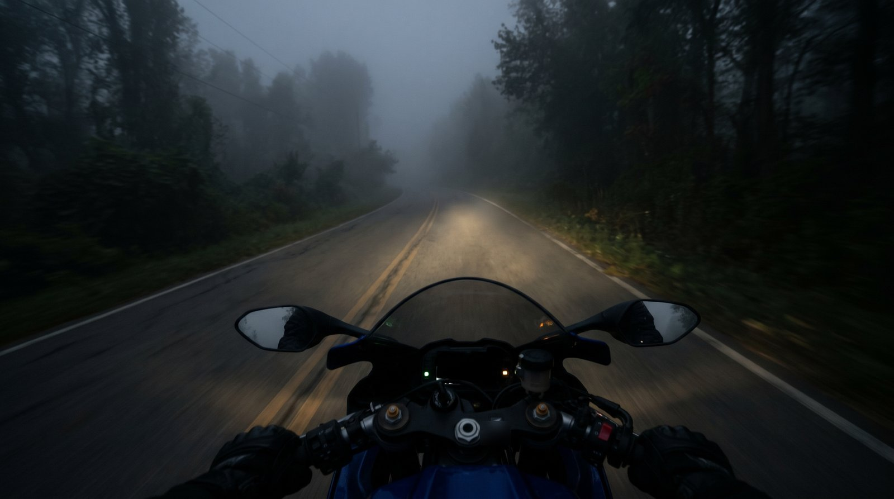
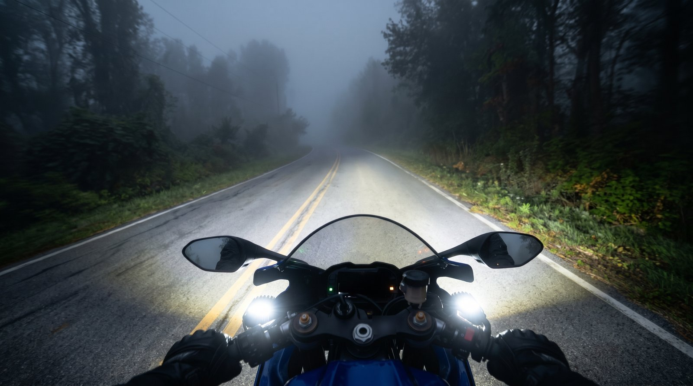
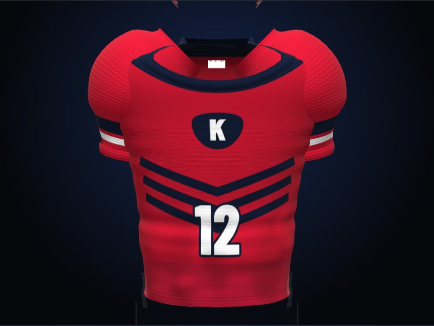
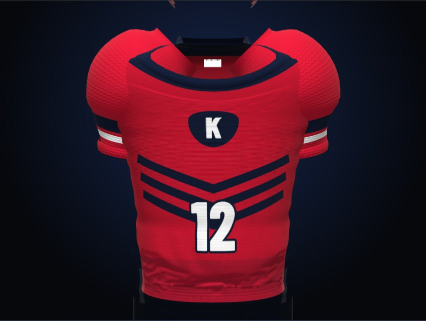

# AI-assisted 3D modeling: method and case studies

How I use 3D and AI to answer a customer's question before anything is bought
or produced, and how I keep the result honest: every model is checked against a
measurement, a reference or a scripted render, and anything that cannot be
verified is labelled as representative.

This repository explains the reasoning behind two client projects (kept
anonymous), the working method they share, and a few small example scripts.
It contains no client files, no model files (.blend, .glb, .stl) and no brand
material.

Author: Muhammed Eren Albayrak

> Türkçe özet en altta.

---

## The idea in one paragraph

3D is worth building when a customer cannot decide without seeing the thing in
their own context: an accessory on their own vehicle, a team kit in their own
colours. AI makes that affordable: it produces a plausible shape, scene or
design variant quickly. But plausible is not correct. So I let AI make the
first draft, then pin it to reality with numbers (scale, position, measured
dimensions), check it the same way after every change, and say clearly in the
final output what the visual proves and what it does not.

## Pipeline

Details: [docs/workflow.md](docs/workflow.md)

## Decisions that repeat across projects

| Decision | Trade-off | What I chose |
|---|---|---|
| AI-generated mesh or modelled by hand? | Speed vs dimensional accuracy | AI when only visual likeness is needed; parametric CAD when a part must fit or carry load |
| How realistic must it be? | Visual quality vs file size and load time on a phone | Measure where realism comes from first, then spend effort there |
| What may the visual claim? | Persuasion vs honesty | Every AI-generated model or scene is labelled representative, with the limit stated in words |
| How do we know a change is better? | Speed vs evidence | Scripted renders from fixed cameras and before/after pairs on every change |
| 3D first, or value first? | Wow effect vs cost per product | Where 3D cost grows with every new product, the cheaper non-3D answer goes first |

## Case 1: Motorcycle accessory fit configurator

**Problem.** A motorcycle gear shop gets the same two questions again and again:
"will this fit my bike?" and "what will it actually do for me?". The customer
cannot see an accessory on their own bike before buying, and the value of a
crash bar or a fog light is invisible until the moment it is needed.

**Idea.** Pick your bike, tap an accessory, see it mounted on a rotatable 3D
model of that bike, then slide between two images of the situation it is made
for.

| Without fog lights | With fog lights |
|---|---|
|  |  |

**Why 3D + AI, and the trade-off.** Modelling a bike and its accessories by hand
would have cost more than a prototype is worth, so the meshes were generated
from photographs with AI. That buys speed and visual likeness, not dimensions.
Accessories are therefore placed by explicit numbers, and the page states that
the models are representative and that fit comes from catalogue data.

**Outcome.** A working prototype for one bike and four accessories, and a
decision it made visible: every new bike needs its own model and placements, so
the plan puts a non-3D compatibility layer first and 3D later.

Full write-up: [docs/case-motorcycle-accessory-fit.md](docs/case-motorcycle-accessory-fit.md)

## Case 2: Sportswear jersey configurator

**Problem.** A team ordering custom jerseys wants to see the kit in its own
colours, name and number before anything is printed; a flat drawing does not
show how it looks on a body.

**Idea.** A browser configurator that builds the jersey in 3D from the team's
input and shows design variants side by side.

| Before cloth bake | After cloth bake |
|---|---|
|  |  |

**Why 3D + AI, and the trade-off.** The cut has to change live, so the garment
is generated in code, not downloaded, and that made it look artificial. Instead
of guessing, I measured how five existing configurators achieve realism, then
added a real cloth simulation from Blender, baked onto the same mesh so printed
numbers do not move. AI is used for design variants and reference drafts, never
for the garment geometry, and the page still works if the AI service is down.

**Outcome.** More natural fabric, and colours that match the chosen values: the
on-screen difference for the team red dropped from 69 to 10 after a measured
lighting change. Limits are written down: sleeves are not simulated, and texture
resolution is still below the inspected competitors.

Full write-up: [docs/case-sportswear-jersey.md](docs/case-sportswear-jersey.md)

## Tools that appear in these projects

| Area | Tools |
|---|---|
| AI shape generation | Image-to-3D generators (Hunyuan, Tripo and Meshy compared side by side in one project) |
| AI images and text | An image model for reference drafts and fabric patterns; Claude for structured design variants behind a server proxy |
| Mesh work and baking | Blender 5.x with Python (`bpy`), cloth simulation, Cycles normal/AO baking |
| Parametric CAD | OpenSCAD, Rhino 8 Python, Fusion script handoff |
| Analysis | gmsh + scikit-fem linear static solver, checked against an analytic beam first; OrcaSlicer CLI |
| Web delivery | three.js |
| Verification | Playwright headless renders from fixed cameras, Pillow/numpy |

## Scripts

Small, self-contained examples, see [scripts/README.md](scripts/README.md).

## Lessons and limits

- AI meshes are visual, not dimensional. They are scaled to one known size and
  labelled representative; they are never used as engineering measurements.
- Fit is per product. Hand-tuned placements do not transfer from one vehicle to
  the next, which is why the non-3D answer comes first in Case 1.
- Measure where realism comes from before spending effort on it.
- Placeholders must be visible. Unmeasured values are marked in the source and
  reported by the pipeline, so a guess never ships silently.
- Verification is cheap when it is scripted.

## License

Code in `scripts/` is released under the MIT License (see [LICENSE](LICENSE)).
Images in `media/` and the text in `docs/` and this README are
© Muhammed Eren Albayrak, all rights reserved; they are shown as portfolio
material and may not be reused without permission.

---

## Türkçe özet

Bu repo, 3D ve yapay zekâyı bir müşterinin satın almadan ya da üretimden önce
karar verebilmesi için nasıl kullandığımı anlatır. Yapay zekâ ilk taslağı
(fotoğraftan 3D model, sahne, tasarım varyantı) hızlıca üretir; ben onu ölçüye,
konuma ve ölçeğe sayılarla bağlar, her değişiklikten sonra aynı kamera
açılarından kontrol eder ve doğrulanamayan her şeyi "temsili" olarak
etiketlerim.

İki anonim vaka var: motosiklet aksesuar uyum konfigüratörü (müşteri aksesuarı
kendi motorunda görmeden alamıyor; çözüm 3D önizleme, ama maliyet nedeniyle
önce 3D'siz uyum katmanı) ve spor forma konfigüratörü (takım formayı üretimden
önce kendi renkleriyle görmek istiyor; gerçekçilik ölçülerek Blender kumaş
simülasyonuyla artırıldı). `scripts/` altındaki örnekler MIT lisanslıdır;
görseller ve metinler tüm hakları saklıdır.
