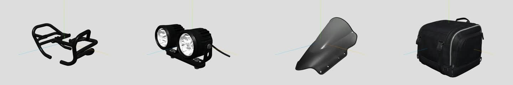
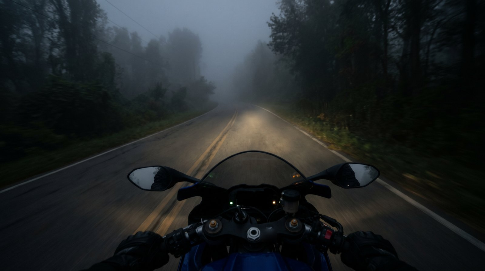
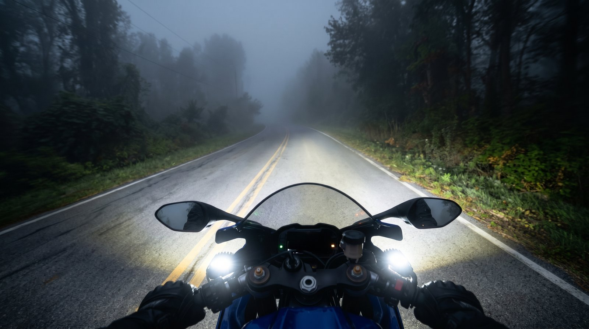

# Case 1: Motorcycle accessory fit configurator

**Type:** concept prototype for a motorcycle gear retailer (client kept
anonymous), October 2026.
**Scope:** one 250cc sport motorcycle and four example accessories: crash bar,
LED fog light set, touring windscreen, 20 L tail bag.

## 1. The problem

Two questions keep reaching the shop by phone:

1. **"Will this fit my bike?"** Windscreens, crash bars and luggage racks are
   model specific. Today the customer searches a category tree or calls.
2. **"What will it do for me?"** The value of a fog light or a crash bar is
   invisible on a product page until the moment it is needed.

Both questions block a purchase for the same reason: the customer cannot see the
accessory in their own situation.

## 2. Why 3D, and why AI

- **3D** answers question 1 visually: the accessory sits on a model of the
  customer's own bike, which they can turn with a finger.
- **Before/after images** answer question 2: a foggy road with and without fog
  lights, a tipped-over bike with and without a crash bar.
- **AI** makes both affordable for a prototype. Modelling a motorcycle and four
  accessories by hand would have cost more than the prototype was worth. Instead
  the meshes were generated from photographs with an AI image-to-3D tool, and the
  before/after scenes with an image model.

The price of that speed is accuracy: an AI mesh looks right but has no reliable
dimensions. Every later decision follows from accepting that openly.

## 3. Decisions and trade-offs

**Pin the AI mesh to one real number.** The bike is scaled so its length is
2.0 m, close to the real vehicle, and that length becomes the unit for
everything else. One known dimension is enough for a convincing visual; it is
not enough for engineering, and the page does not pretend otherwise.

**Placement is data, not hand-dragging.** Each accessory carries three numbers:
position (in bike lengths), rotation, and largest size (as a fraction of bike
length). Because placement is data, it can be reviewed, versioned and tested,
and a future catalogue can store one record per bike-accessory pair.

```js
{ id: 'windscreen', fit: { pos: [-0.27, 0.50, 0], rot: [0, 180, 0], size: 0.2 } }
```

**Choose variants by rendering, not by eye.** The correct rotation of an AI mesh
is not obvious from the file. A script wrote three candidate rotations for the
windscreen into the data file, rendered each from a fixed side and front camera
in a headless browser, and restored the file. The kept value was picked from
that grid.

**Accept a size budget.** The five AI models came out at about 61.5 MB, too heavy
for a phone. Recompressing only the textures (geometry untouched) brought them to
about 18.8 MB. Further savings would have meant visibly worse models, so the
remaining weight was accepted for a prototype.



**Label what is representative.** The page and the concept document say, in
words, that the 3D models were generated by AI from photographs, are visually
realistic but not engineering measurements, that fit information must come from
the catalogue, and that the before/after scenes are representative. Each scene
also carries a specific caveat (a crash bar does not give full protection at
high speed; fog light use is subject to traffic rules).

| Without fog lights | With fog lights |
|---|---|
|  |  |

## 4. Outcome

- A working prototype: choose the bike, tap an accessory, it appears on the 3D
  bike, and a "what it does" drawer opens with a before/after slider.
- A clearer plan than "build 3D for everything". The prototype made the cost
  visible: every new bike needs its own model and its own hand-tuned placement
  for every accessory. The concept therefore puts value first. Stage 1 is a
  compatibility layer (register your bike once; every product shows "fits",
  "fits with an extra part" or "does not fit", plus a short "what it does"
  text), which needs catalogue data but no 3D models. The 3D view comes later,
  starting from the best-selling bikes.

## 5. Limits

- The 3D models are AI-generated and representative; they are not engineering
  measurements.
- Accessory positions are tuned by hand for one bike model and do not transfer.
- Before/after scenes are representative; product claims are limited to the
  manufacturer's information.
- The prototype covers one bike and four example products.

## Technical notes

- Viewer: three.js with GLTFLoader and OrbitControls.
- Models exported from Blender as GLB; textures recompressed with
  [scripts/gltf/shrink_glb_textures.py](../scripts/gltf/shrink_glb_textures.py).
- The demo host did not allow `fetch` on `data:`/`blob:` URLs, so models are
  shipped as single-file glTF JSON
  ([scripts/gltf/glb_to_embedded_gltf.py](../scripts/gltf/glb_to_embedded_gltf.py))
  and rebuilt into a GLB buffer in the browser.
- Placement in the viewer: rotate, scale so the largest bounding-box side equals
  `size × unit`, move the bounding-box centre to `pos × unit`.
- Renders for review: Playwright with software WebGL, fixed camera positions
  passed in the URL.
