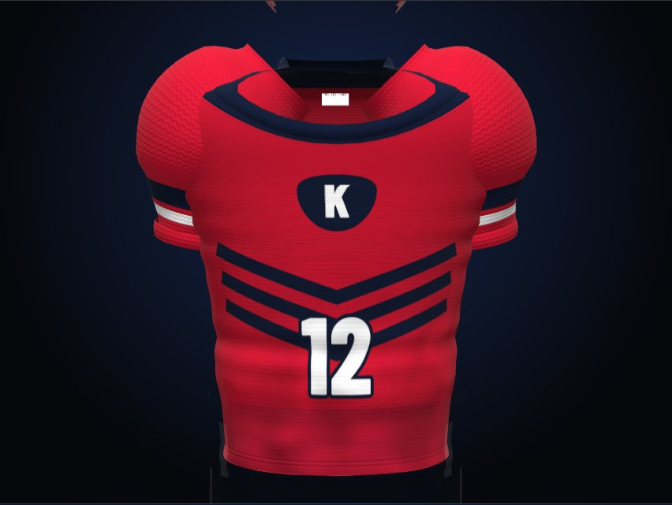
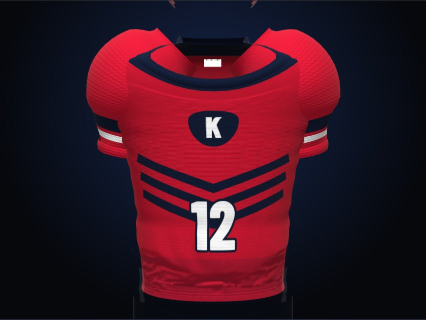
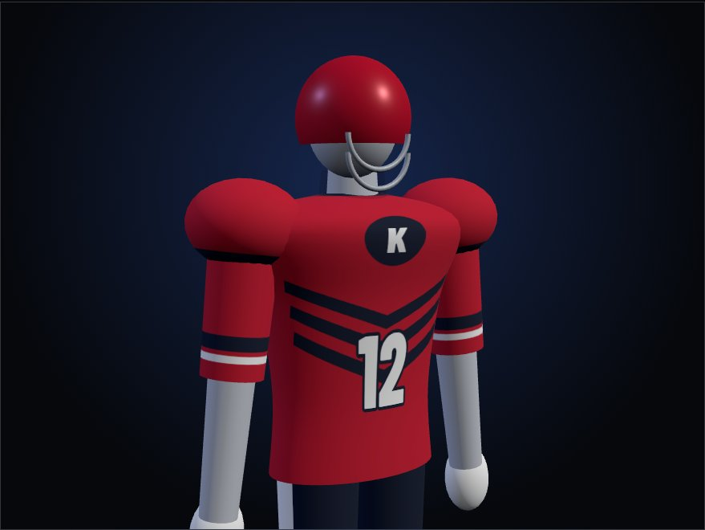
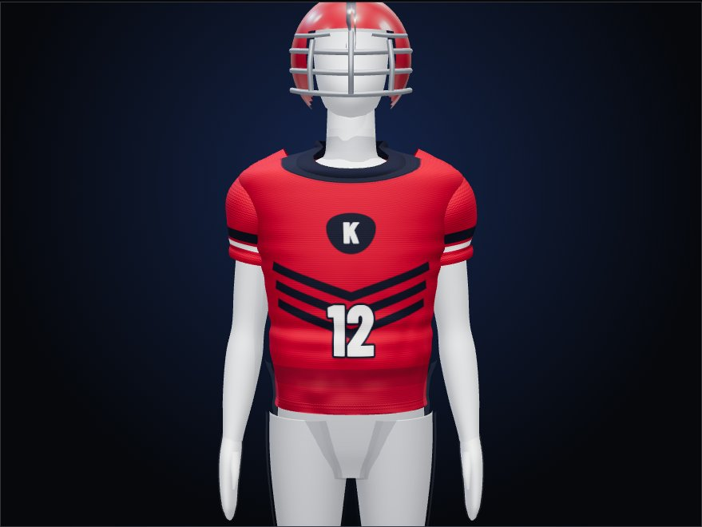
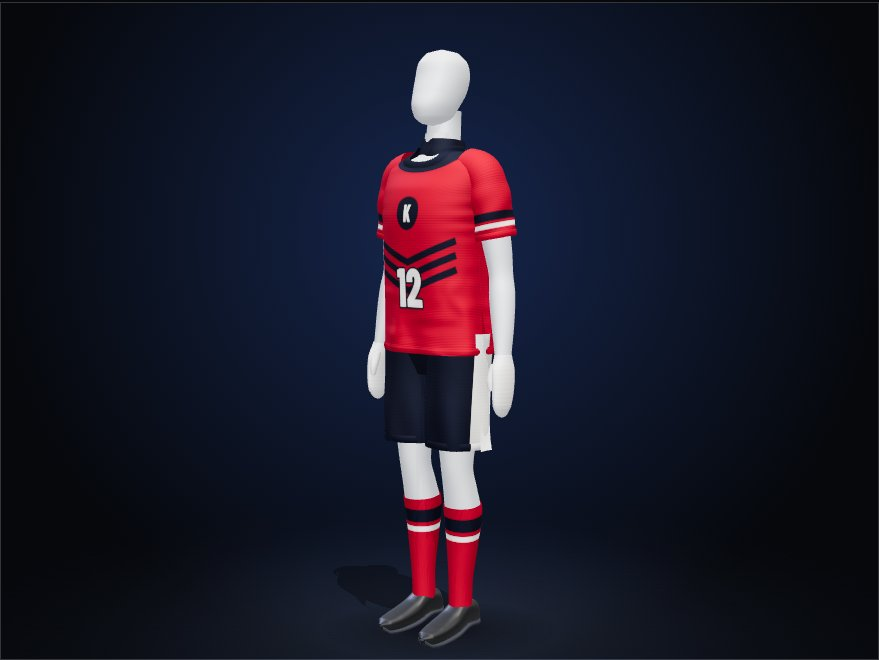

# Case 2: Sportswear jersey configurator

**Type:** browser prototype for a sportswear brand (client kept anonymous),
October to November 2026.
**Scope:** a 3D team-kit designer for three cuts (American football jersey,
men's flag football, women's flag football) with pants, socks and accessories.
The sample team in the images ("K", number 12) is fictional.

## 1. The problem

A team ordering custom sublimated jerseys wants to see the result before
anything is printed: its own colours, name and number, on a body, from the
front, side and back. A flat front/back drawing does not show that, and a
mistake found after printing is expensive.

## 2. Why 3D, and why AI

- **3D** lets the team turn the kit around and switch cuts (tackle, men's flag,
  women's flag) and see the same design on each.
- **The garment is generated in code, not downloaded.** Cut, sleeve and collar
  must change live with user input; a fixed model file cannot do that.
- **AI** helps with ideas, not with geometry:
  - an image model produced front/back reference drafts per cut for colour and
    pattern ideas (reference only; drafts that copy a real team's or brand's
    design are discarded);
  - Claude, behind a server proxy, proposes structured design variants (name,
    pattern, motif, colours, number style) from the team's colours and a short
    note;
  - an optional button asks the image model for a fabric pattern, with number
    and emblem kept on top.

## 3. Decisions and trade-offs

**The first version looked artificial. Measure before fixing.** Rather than
guessing, five public jersey configurators were inspected in a headless browser
(engine, triangle count, texture sizes, lights, tone mapping; numbers only,
nothing downloaded). Three findings set the priorities:

- realism came from garment geometry and baked fabric textures, not from lights;
- tone mapping was off wherever it could be read, so team colours stay true;
- graphics were multiplied over a baked shading map, so wrinkles survive any
  colour.

**Colour fidelity over cinematic look.** Turning tone mapping off and
rebalancing the lights was checked on screen pixels against the chosen
colours: the difference for the team red went from 69 to 10, for the navy from
26 to 8.5. A slightly flatter image was the right price for colours a team will
recognise as theirs.

**Real wrinkles without losing live editing.** Replacing the procedural garment
with a scanned or sculpted one would have broken live cut changes. Instead the
existing web mesh was exported, simulated as cloth in Blender, and the wrinkles
were baked back onto the same mesh and UVs as normal and shadow maps. Because
nothing about the mesh changes, printed numbers and names do not move. This
replaced an earlier code-generated wrinkle approximation.

| Before | After |
|---|---|
|  |  |

**AI must be optional.** If the AI service fails, is rate-limited or has no key,
the page falls back to built-in rule-based designs and still works. Input is
cleaned on the server, output token count is capped, and rate limits return a
clear "try again in N seconds" message instead of failing silently.

**Every round is shown, not claimed.** Each visual round was captured as
before/after screenshots from fixed views, for every cut, at desktop and mobile
widths (179 images for the 3D work alone).

An earlier round (before the cloth bake) rebuilt the figure with human
proportions, layered garments and colour-faithful lighting:

| Earlier procedural figure | Revised |
|---|---|
|  |  |

## 4. Outcome

- A configurator in which the team picks a cut, colours, name and number and
  sees the kit in 3D, with rule-based and AI-proposed variants.
- Visibly more natural fabric and measured colour fidelity.
- A written list of what is still missing, instead of an implied "done".

## 5. Limits

- Sleeves were not simulated (short sleeves, small wrinkle contribution).
- Faint horizontal bands under the chest come from the procedural mesh itself.
- The silhouette is still procedural; wrinkles live only in the textures.
- Texture resolution (1024 × 512 for the whole jersey) is 4 to 16 times lower
  than the inspected competitors; a pattern-piece UV layout at 2048² is the next
  planned step.

## Technical notes

1. **Export.** A Playwright script loads the configurator in WebKit, adds a
   temporary hook to the page's module at load time (repository code is not
   changed) and writes each cut's body and sleeve mesh to JSON.
2. **Simulate (Blender 5.2, `bpy`).** Rebuild the mesh, weld seams, add a
   collider shrunk 14 mm inward as the torso, subdivide a copy (10,080 to 40,320
   faces), pin shoulders and the tucked-in hem, give only the lower body about
   4 % slack, simulate 60 frames, freeze. The women's cut needed its own pin
   range to avoid an artificial line under the chest.
3. **Bake (Cycles).** Tangent-space normal map and ambient occlusion
   (48 samples) onto the original UVs, 1024 × 512 each.
4. **Post-process.** Undo a temporary UV shift, blur ray-miss artefacts in deep
   folds, clamp normal strength, lift the AO floor, write WebP.

Scripts: [cloth_bake.py](../scripts/blender/cloth_bake.py),
[postprocess_bake_maps.py](../scripts/blender/postprocess_bake_maps.py).
